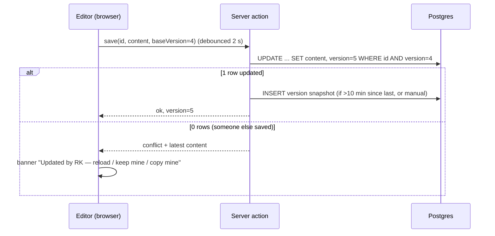
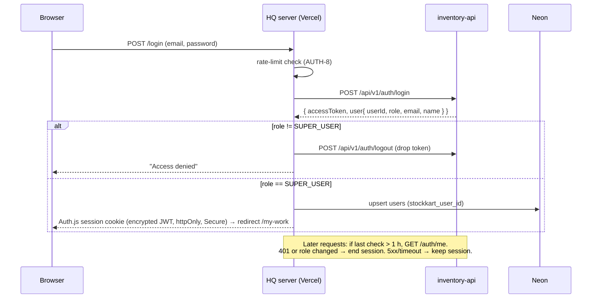
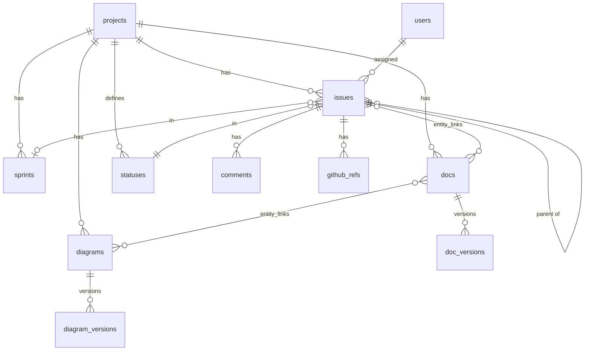

# Stockkart HQ — Product & Technical Spec

Status: Draft v2 · Owner: imfali · Repo: `Stockkart/stockkart-hq` (public) · Hosting: Vercel Hobby (non-commercial) · DB: Neon Postgres · Sign-in: Stockkart accounts with role `SUPER_USER`

Decisions so far:
- Name: **Stockkart HQ** (`stockkart-hq`).
- Database: Neon Postgres. Repo is public; data stays private behind login.
- Sign-in uses existing Stockkart (inventory-api) accounts; only users with role `SUPER_USER` get in (§7.5, §11).
- HQ is the **source of truth** for docs, ADRs and runbooks after the one-time import. `engineering-handbook` becomes a published snapshot, refreshed via "Export .md" + PR (DOC-12).

---

## 1. Summary

Stockkart HQ is a small, private, Jira-plus-Confluence app for the Stockkart team (2 people today, max 5). It holds three kinds of things in one place and links them together:

1. **Work** — epics, stories, tasks, bugs, todos, sprints, priorities, assignees.
2. **Knowledge** — design docs, ADRs, runbooks, postmortems, API contracts, written from templates.
3. **Pictures** — architecture diagrams (whiteboard), flows (node graphs) and Mermaid diagrams.

The killer feature is the **links between them**: a bug points at the PR that fixed it in `inventory-api`, the ADR that explains the decision, and the diagram of the flow it touched.

### Before vs after

```
BEFORE                                         AFTER
──────                                         ─────
points.txt            (todos in a text file)   ┌───────────────── Stockkart HQ ─────────────────┐
engineering-handbook/ (ADRs, runbook in git)   │  STK-42 Bug: OOM on 10 MB OCR upload  [P0]       │
scaling-research.md   (loose notes)            │    ├─ PR  inventory-api#118  (merged)  ✔         │
diagrams              (somewhere else)         │    ├─ ADR-0011 One-shot migrations               │
GitHub PRs            (no link to "why")       │    ├─ Doc  Load-test report 2026-05              │
                                               │    └─ Diagram  OCR upload flow                   │
Nothing links. Context lives in heads.         └──────────────────────────────────────────────────┘
                                               One search box finds all of it.
```

### Goals

- Track all Stockkart work for 2–5 people with near-zero ops and **$0/month**.
- Make every technical decision and design discoverable and linked to the work.
- Fast, keyboard-friendly, clean UI (SIM-T / Linear quality bar, not Jira clutter).

### Non-goals (v1)

- Real-time multi-cursor co-editing (we use optimistic locking instead — §9.4).
- Public/anonymous share links. Everything is behind login.
- Mobile apps (responsive web is enough), time tracking, billing, multi-tenant SaaS, AI features.

---

## 2. Users and roles

There is one role in HQ: everyone who can sign in has full access.

| Who | How they get in | Can |
|---|---|---|
| Any Stockkart user with role `SUPER_USER` (internal Stockkart staff only, never shop users) | Signs in with their Stockkart email + password (Google later, P1) | Everything: issues, docs, diagrams, sprints, project settings |
| Any other Stockkart user (OWNER, ADMIN, MANAGER, CASHIER) | Rejected: "Access denied" | Nothing |

- Who is a SUPER_USER is managed **in inventory-api**, not in HQ. HQ has no invite screen.
- The HQ user record is created automatically on first sign-in, keyed by the Stockkart `userId`.
- Each person sets their GitHub username once in their HQ profile, so PRs and commits map to them (GH-2).
- Expected 2–5 users. A Viewer role can be added later if needed.

---

## 3. Core concepts (glossary)

```
Workspace (one: Stockkart)
 └─ Project  (key "STK"; more projects possible later)
     ├─ Components   inventory-api · inventory-platform · infra · loadtest · hub
     ├─ Issues       Epic ─► Story / Task / Bug / Spike / Tech-debt ─► Subtask
     ├─ Sprints      2-week (configurable) time boxes
     ├─ Releases     versions, e.g. api-v1.4, platform-v2.0
     ├─ Docs         page tree; each doc has a type (Design, ADR, Runbook, …)
     ├─ Diagrams     whiteboard (Excalidraw) or flow (React Flow)
     ├─ Incidents    outages + link to postmortem
     └─ Services     registry of what runs where
```

| Term | Meaning |
|---|---|
| Issue key | `STK-123`, unique per project, never reused |
| Status category | Every status belongs to `todo`, `in_progress` or `done`; reports use categories |
| Entity link | A typed link between any two things (issue↔doc, doc↔diagram, issue↔issue) |
| Template | A starting document/diagram/issue body; "New from template" copies it |
| ADR | Architecture Decision Record — one page recording one decision, its context and consequences |

---

## 4. Functional requirements

Priority: **P0** = MVP, **P1** = next, **P2** = later. IDs are stable so we can reference them in tickets.

### 4.1 Auth & access

| ID | Requirement | Pri |
|---|---|---|
| AUTH-1 | Login page with email + password. The HQ server calls inventory-api `POST /api/v1/auth/login` (server-to-server, so no CORS change) | P0 |
| AUTH-2 | Access only if the returned `user.role == SUPER_USER`; otherwise show "Access denied" and call inventory-api logout to drop the token | P0 |
| AUTH-3 | Session is managed by Auth.js (JWT strategy, httpOnly Secure cookie, encrypted with `AUTH_SECRET`). Max age ≤ 7 days, never longer than the Stockkart token | P0 |
| AUTH-4 | Re-check `GET /api/v1/auth/me` at most once per hour per session. A 401 or a role other than SUPER_USER ends the session at once. Network errors or 5xx keep the session (so HQ still works while inventory-api is down) | P0 |
| AUTH-5 | Every page and API route requires a session, except `/login` and `/api/webhooks/github` (signature-verified) | P0 |
| AUTH-6 | Server actions re-check the session on every mutation (middleware alone is not trusted) | P0 |
| AUTH-7 | Logout ends the HQ session and calls inventory-api `POST /api/v1/auth/logout` | P0 |
| AUTH-8 | Login rate limit: 5 failed attempts per email per 15 min, and 20 per IP per 15 min | P0 |
| AUTH-9 | "Sign in with Google": get a Google ID token in the browser, then send it to inventory-api login (`loginType: google`). Needs the HQ domain added to the Google OAuth client's authorized origins | P1 |

### 4.2 Projects & components

| ID | Requirement | Pri |
|---|---|---|
| PRJ-1 | Create project with name, key (2–5 uppercase letters), description, lead | P0 |
| PRJ-2 | Components per project, each optionally mapped to a GitHub repo (`Stockkart/inventory-api`) | P0 |
| PRJ-3 | Project settings: statuses (rename, reorder, add, set category), labels, default assignee, sprint length | P1 |
| PRJ-4 | Archive project (read-only, hidden from nav) | P2 |

### 4.3 Issues

| ID | Requirement | Pri |
|---|---|---|
| ISS-1 | Types: Epic, Story, Task, Bug, Spike, Tech-debt, Subtask | P0 |
| ISS-2 | Fields: title, description (rich text), type, status, priority (P0 Critical, P1 High, P2 Medium, P3 Low; default P2), assignee, reporter, labels, component, story points, due date, sprint, release, parent | P0 |
| ISS-3 | Parent rules: Story/Task/Bug/Spike/Tech-debt → Epic; Subtask → any non-epic issue | P0 |
| ISS-4 | Quick create (`C` key or "+" button) — only title required; type/priority inline | P0 |
| ISS-5 | Issue detail page: editable fields in a side panel, description, subtasks, links, comments, activity | P0 |
| ISS-6 | Issue links: blocks / is blocked by / relates to / duplicates / is duplicated by | P0 |
| ISS-7 | Comments with rich text, @mentions, edit/delete own; `STK-12` in text becomes a link chip | P0 |
| ISS-8 | Activity history: who changed what field from → to, when | P0 |
| ISS-9 | Attachments (images, PDFs, logs) via drag-drop or paste | P1 |
| ISS-10 | Issue templates per type (Bug: steps to reproduce / expected / actual / env / logs) | P0 |
| ISS-11 | Watchers; assignee and reporter auto-watch | P1 |
| ISS-12 | Bulk edit from list/backlog: status, assignee, priority, sprint, labels | P1 |
| ISS-13 | Soft delete with 30-day restore from "Trash" | P1 |
| ISS-14 | Clone issue; convert type (e.g., Task → Bug) | P2 |

### 4.4 Workflow

Default statuses (one set per project):

| Status | Category | Notes |
|---|---|---|
| Triage | todo | Default for new Bugs |
| Backlog | todo | Default for everything else |
| Todo | todo | Committed / ready |
| In Progress | in_progress | |
| In Review | in_progress | Set by hand while a PR is open (GH-3 does not move it) |
| Done | done | Sets `resolved_at` |
| Won't Do | done | Sets `resolved_at`, excluded from velocity |

- WF-1 (P0): any status → any status allowed (small team; no transition rules).
- WF-2 (P1): optional rule "moving to Done requires all subtasks Done" (warn, not block).

### 4.5 Backlog

| ID | Requirement | Pri |
|---|---|---|
| BLG-1 | Ranked list of all not-done issues not in an active sprint, drag to reorder | P0 |
| BLG-2 | Group by: none / epic / component / assignee; collapse groups | P0 |
| BLG-3 | Sprint sections above the backlog; drag issues into a sprint | P1 |
| BLG-4 | Inline edit of priority, assignee, points; total points per section | P0 |
| BLG-5 | Filter bar (see §4.10) | P0 |

### 4.6 Board

| ID | Requirement | Pri |
|---|---|---|
| BRD-1 | Kanban columns = statuses; drag cards between columns (optimistic update) | P0 |
| BRD-2 | Card shows key, title, type icon, priority, assignee avatar, points, labels | P0 |
| BRD-3 | Board scope: a sprint picker with the active sprint (the default, plain URL), any planned sprint (`?sprint=<id>`) or all open issues (`?scope=all`; the default when no sprint is active). A sprint that is not open in the project redirects to the default board | P0 |
| BRD-4 | Swimlanes: none / assignee / epic / priority | P1 |
| BRD-5 | WIP limit per column (column turns amber when over) | P2 |
| BRD-6 | Board view: filter by issue type (none picked = every type) and show/hide status columns, in the URL (`types=`, `hide=`); without them the project's board defaults apply (Settings → Views; "Save as default" / "Reset to default" on the board). At least one column stays visible; cards in hidden columns are counted with a "Show" link; hidden columns are no drop targets, but "Move to…" lists every status. WIP counts are of the cards shown | P2 |

### 4.7 Sprints

| ID | Requirement | Pri |
|---|---|---|
| SPR-1 | Create sprint (name, goal, start, end); one active sprint per project | P1 |
| SPR-2 | Complete sprint: choose where unfinished issues go (next sprint or backlog) | P1 |
| SPR-3 | Burndown (points remaining per day), computed from activity log — no cron needed | P1 |
| SPR-4 | Velocity chart: completed points for last 6 sprints | P1 |
| SPR-5 | Sprint retro doc auto-created from template on completion (optional toggle) | P2 |

### 4.8 Roadmap & releases

| ID | Requirement | Pri |
|---|---|---|
| RDM-1 | Timeline of epics (start → target date), progress bar = % of child points done | P2 |
| RDM-2 | Dependencies drawn from "blocks" links between epics | P2 |
| REL-1 | Releases with name, date, status (Unreleased/Released); issues have "Fix version" | P2 |
| REL-2 | "Generate release notes" → new doc from template listing done issues grouped by type | P2 |

### 4.9 My Work & todos

| ID | Requirement | Pri |
|---|---|---|
| MY-1 | "My Work" page: assigned to me (grouped by status), recently viewed, mentions | P0 |
| MY-2 | Personal todo list / scratchpad (the `points.txt` replacement): quick add, check off, reorder | P0 |
| MY-3 | "Promote to issue" on a todo → creates issue with the todo text, links back | P0 |

### 4.10 Views, filters, search

| ID | Requirement | Pri |
|---|---|---|
| VW-1 | Issue list view with sortable columns and filter bar: type, status, priority, assignee, component, label, sprint, text | P0 |
| VW-2 | Filters reflected in the URL (shareable between teammates) | P0 |
| VW-3 | Saved views (personal or shared), e.g. "Open P0/P1 bugs — inventory-api" | P1 |
| VW-4 | Issue list defaults per project (Settings → Views): default issue types and hidden statuses, applied only when the URL has no `type`/`status` and no saved view is open (a saved view's own filters win); shown as active filter chips; "Clear filters" returns to them, "Show all" drops them (`type=all`), "Save as default" stores the current types and statuses | P2 |
| VW-5 | The board and the backlog remember their last view (sprint, types, hidden columns, filters, group) per project in the browser; the sidebar and the command palette reopen it. The plain URL (typed, shared, or after "Clear filters"/"Reset to default") shows the defaults and clears what is remembered | P2 |
| SRCH-1 | Global search (`Cmd/Ctrl+K`) over issues, docs, diagrams, comments; `STK-123` jumps directly | P0 |
| SRCH-2 | Postgres full-text search with ranking; result type icons and snippets | P0 |
| SRCH-3 | Command palette actions in the same box: "Create bug", "Go to board", "New ADR" | P1 |

### 4.11 Docs & templates

| ID | Requirement | Pri |
|---|---|---|
| DOC-1 | Block editor (headings, lists, checklists, tables, code blocks, callouts, images) | P0 |
| DOC-2 | Page tree per project; drag to nest/reorder | P0 |
| DOC-3 | Doc type: Page, Design (HLD), LLD, ADR, RFC, API Contract, Runbook, Postmortem, Load-test Report, Meeting Notes, Retro, Release Notes, Onboarding | P0 |
| DOC-4 | Doc status: Draft / In Review / Approved / Obsolete; owner; last updated by/at | P0 |
| DOC-5 | "New from template" picker with preview; built-in templates in §6 | P0 |
| DOC-6 | Admin can save any doc as a custom template | P1 |
| DOC-7 | Mermaid block: code on the left, live render on the right; errors shown inline | P0 |
| DOC-8 | Embed block for a HQ diagram (live thumbnail, click to open) | P1 |
| DOC-9 | `STK-123` and @user auto-link; "Linked issues" side panel | P0 |
| DOC-10 | Autosave (debounced ~2 s) + version history with restore and diff of text | P1 |
| DOC-11 | Comments on a doc (page-level) | P1 |
| DOC-12 | Export to Markdown. HQ is the source of truth; when the repo copy needs refreshing (coding agents and `AGENTS.md` read ADRs from git), export and PR the file into `engineering-handbook` | P1 |
| DOC-14 | Two-way handbook sync with the public `engineering-handbook` repo (GitHub App, README "Engineering handbook sync"). **HQ → repo:** "Publish to handbook" (one doc, or up to 50 from Settings → Handbook) opens ONE pull request on an `hq/publish-<yyyymmdd>-<id>` branch with every file in one commit; never a push to the default branch. Each publish shows the public-repo warning; a secret-looking value blocks it (no override); a file changed in the repo since the last sync is refused ("pull first") unless the person reviewed that exact blob's diff and chose to overwrite; an identical file is skipped; a doc is in at most one open PR. A merged PR marks its docs in sync; a closed one changes nothing. **Repo → HQ:** pushes to the default branch (org webhook, no GitHub call in the request) mark the touched docs "Changed in handbook" or "Removed in handbook" (HQ's own merge excluded); "Review & pull" shows the diff and applies the file as a new HQ version (repo ahead = clean pull; both changed = take the handbook's, keeping HQ's copy in the history, or keep HQ's and overwrite through a PR). "Check handbook now" (once a minute per project) compares every mapped doc with the default branch and lists unmapped top-level / `decisions/NNNN-*.md` files to import. Statuses: Not in handbook, In sync, Changed in HQ, Changed in handbook, Both changed, PR open, Removed in handbook | P2 |
| DOC-13 | Inline comments anchored to a text selection | P2 |

### 4.12 ADRs

ADRs are docs with `type = adr` plus extra fields. The template mirrors the existing `engineering-handbook/decisions/0000-template.md` exactly.

| ID | Requirement | Pri |
|---|---|---|
| ADR-1 | Auto-number `NNNN` (next after the highest imported, i.e. 0011) | P0 |
| ADR-2 | Status: Proposed, Accepted, Accepted (recorded retrospectively), Deprecated, Superseded by NNNN | P0 |
| ADR-3 | "Supersede" action creates a new ADR and updates the old one's status both ways | P1 |
| ADR-4 | ADR log page: table of number, title, status, date, linked issues | P0 |
| ADR-5 | Recorded-against SHAs for inventory-api / inventory-platform (text fields) | P1 |

### 4.13 Diagrams & flows

| ID | Requirement | Pri |
|---|---|---|
| DGM-1 | Whiteboard diagrams with Excalidraw (boxes, arrows, text, freehand, images) | P1 |
| DGM-2 | Flow diagrams with React Flow: typed nodes (Service, DB, Queue, External, Actor, Decision), labelled edges, auto-layout | P1 |
| DGM-3 | Diagram templates (see §6.3), e.g. "Stockkart system context" pre-filled | P1 |
| DGM-4 | Autosave + version history (same mechanism as docs) | P1 |
| DGM-5 | PNG thumbnail generated on save, shown in lists and doc embeds | P1 |
| DGM-6 | Export PNG/SVG; React Flow export also as Mermaid flowchart text | P2 |
| DGM-7 | Link a diagram node to an issue or doc (click node → open) | P2 |

### 4.14 Incidents & services

| ID | Requirement | Pri |
|---|---|---|
| INC-1 | Incident: title, severity (SEV1–SEV3), status (Investigating/Mitigated/Resolved), start/end, commander, affected services, timeline notes | P2 |
| INC-2 | "Create postmortem" → doc from template, linked; follow-up issues linked | P2 |
| SVC-1 | Service registry: name, repo, runtime/host (e.g. DigitalOcean App Platform, Vercel), envs, URLs (app, logs, dashboard, DB console), owner, notes. **No secrets** | P2 |

### 4.15 GitHub integration

| ID | Requirement | Pri |
|---|---|---|
| GH-1 | Org-level webhook (`pull_request`, `push`, `create`) for `Stockkart` → `/api/webhooks/github`, verified with `X-Hub-Signature-256`; deduped by `X-GitHub-Delivery` | P1 |
| GH-2 | Find issue keys (`STK-\d+`, any case) in branch name, PR title/body, commit messages; attach branch/PR/commit to the issue | P1 |
| GH-3 | PR state changes update the linked PR only (opening a PR does not change the issue). PR merged into the default branch with "Closes/Fixes/Resolves STK-123" → the project's done status, unless already done | P1 |
| GH-4 | Issue "Development" panel: branch, PRs (state, author), commits | P1 |
| GH-5 | "Copy branch name" button: `stk-123-short-title` | P0 |

### 4.16 Notifications

| ID | Requirement | Pri |
|---|---|---|
| NTF-1 | In-app bell: assigned to you, @mentioned, comment on watched issue, status change on watched issue | P1 |
| NTF-2 | Email digest (Resend free tier), opt-in per user | P2 |

### 4.17 Import

| ID | Requirement | Pri |
|---|---|---|
| IMP-1 | Script `scripts/import-handbook.ts` imports `engineering-handbook/*.md` as docs and `decisions/*.md` as ADRs (number, title, status parsed from the file) | P0 |
| IMP-2 | Markdown → editor blocks; Mermaid code fences become Mermaid blocks | P0 |
| IMP-3 | Runs locally against the DB; imported content is **never committed** to the public repo | P0 |
| IMP-4 | CSV import of issues (title, type, priority, status, assignee) | P2 |

### 4.18 Costs (IMR)

IMR = infrastructure monthly run-rate: what running Stockkart costs per month. `/<KEY>/costs`
(sidebar "Costs"); migration 0007 (`cost_items`, `cost_entries`, `cost_settings`).

| ID | Requirement | Pri |
|---|---|---|
| COST-1 | Cost items per project: name (unique per project, case-insensitive, among live items), vendor, category (hosting, database, storage, email, AI/OCR, domain & DNS, monitoring, source control, payments, other SaaS, other), billing cycle (monthly, yearly, usage), currency (INR or USD), optional expected amount, renewal date, optional linked service (SVC-1), notes. Create, edit, archive / reactivate (archived: no longer expected; past entries still count), soft delete, reorder (drag, plus "Move up/down" from the keyboard). Every change logs an `activity` row (`cost_item`) | P2 |
| COST-2 | One entry per item and month (`period` = the first of the month): amount, currency, kind (actual, estimate, no charge = 0), notes, who entered it. Edited inline on the Month tab; clearing it removes the entry | P2 |
| COST-3 | Money is integer minor units (paise / cents) in `bigint` columns, never floats; at most ₹/$ 9,999,999,999.99 per value. A project has a base currency (default INR). An entry in another currency stores its own `fx_rate_to_base` (required; pre-filled from the settings' "1 USD = x INR", editable, **never fetched from the internet**) and its base amount = amount × rate, rounded **half-up**. The base currency cannot change once entries exist | P2 |
| COST-4 | Month tab (default this month, ‹ › switcher, `?month=YYYY-MM`): a row per active item (plus archived ones paid that month) with category, cycle, service, expected and this month's amount, kind, notes and the change vs last month (↑/↓ %). "IMR this month" = monthly and usage entries (actuals + estimates) + each yearly item's latest payment in the 12 months up to that month ÷ 12 (half-up); "Cash out this month" = every entry of the month (yearly in full). Budget bar against the IMR (amber when over) and the change vs last month. Yearly items show in the month paid; "Show run-rate" spreads them ÷ 12 | P2 |
| COST-5 | "Copy last month": pre-fills this month's missing monthly / usage entries from last month as estimates ("no charge" stays "no charge"; never overwrites). Year tab: items × 12 months with row / column totals, the year total, the average IMR (months so far) and the highest month, a stacked bar chart by category with the same numbers as a table, a year switcher. Export CSV of a month or a year (`/<KEY>/costs/export`, session-gated, `no-store`, `escapeCsvCell`) | P2 |
| COST-6 | "Add Stockkart defaults": DigitalOcean App Platform, MongoDB Atlas, Vercel, Neon Postgres, Cloudflare R2, Domain, Resend, OpenAI, Google Gemini, AWS Textract, GitHub, Grafana Cloud, Razorpay fees, with category, cycle and currency but no amounts; idempotent by name; linked to the service-registry entry of the matching slug when it exists | P2 |
| COST-7 | Monthly reminder in the bell (no email of its own; the NTF-2 digest, when enabled, lists an unread one like any bell entry): from the reminder day (1–28, Stockkart time) of a month, if the PREVIOUS month has expected items without an entry (active, added by then; monthly / usage, or yearly in its renewal month), each recipient (the settings' list, else the project lead) gets one `cost_reminder` bell entry ("October 2026 costs are not added yet (5 items missing)", opening `/<KEY>/costs?month=2026-10`), deduped by `cost_reminder:<projectId>:<YYYY-MM>:<userId>`. Run by `GET /api/cron/monthly` (daily Vercel Cron; Bearer `CRON_SECRET`, constant-time; 503 without the secret, 401 on a wrong one; exact public path). Without the cron the same rule shows a banner on the costs page and a card on My Work | P2 |
| COST-8 | Settings tab: base currency, monthly budget, reminder day, reminder recipients (any HQ users; shown as the lead when empty), default USD → INR rate | P2 |
| COST-9 | Private like everything else: every page, action and the export need a session; amounts are never logged or written to activity rows; costs are not in full-text search (the palette has "Go to Costs") | P2 |

---

## 5. Screens (wireframes)

### 5.1 App shell

```
┌──────────────┬──────────────────────────────────────────────────────────────┐
│ ◆ Stockkart  │  Search or jump to…  (⌘K)                    + Create   🔔  (IA)│
│──────────────│──────────────────────────────────────────────────────────────│
│ My Work      │                                                              │
│ Todos        │                         <page content>                       │
│──────────────│                                                              │
│ STK          │                                                              │
│  Backlog     │                                                              │
│  Board       │                                                              │
│  Issues      │                                                              │
│  Sprints     │                                                              │
│  Roadmap     │                                                              │
│  Docs        │                                                              │
│  ADRs        │                                                              │
│  Diagrams    │                                                              │
│  Incidents   │                                                              │
│  Services    │                                                              │
│──────────────│                                                              │
│ Settings     │                                                              │
└──────────────┴──────────────────────────────────────────────────────────────┘
```

### 5.2 Backlog

```
Backlog  [Type ▾][Priority ▾][Assignee ▾][Component ▾][Label ▾]  Group: Epic ▾
──────────────────────────────────────────────────────────────────────────────
▼ Sprint 7 · Jun 2 – Jun 15 · "Make 2 containers safe"          13 pts [Start]
  ⋮ 🐞 STK-42  OOM restart on 10 MB OCR upload        P0  api   5  (IA)
  ⋮ ✅ STK-45  Add ShedLock to @Scheduled jobs          P1  api   3  (RK)
  ⋮ ✅ STK-47  Delete completed startup migrations      P1  api   5  (IA)
▼ Backlog                                                        21 pts
  ⋮ ⚡ STK-51  Spike: Atlas tier vs ops/s at 500 users  P2  api   2   –
  ⋮ 📘 STK-53  Inventory low-stock alert screen         P2  plat  8  (RK)
  + Create issue
```

### 5.3 Board

```
Sprint 7 ▾   Swimlanes: Assignee ▾
┌ Triage ─┐┌ Todo ────┐┌ In Progress ┐┌ In Review ─┐┌ Done ─────┐
│         ││ STK-47   ││ STK-42  P0  ││ STK-45     ││ STK-40    │
│         ││ Delete   ││ OOM on OCR  ││ ShedLock   ││ Index on  │
│         ││ migr. P1 ││ upload (IA) ││ PR #118 ●  ││ accessTok │
└─────────┘└──────────┘└─────────────┘└────────────┘└───────────┘
```

### 5.4 Issue detail

```
STK-42 · Bug                                               [Copy branch] [⋯]
OOM restart on 10 MB OCR upload
──────────────────────────────────────────────────┬──────────────────────────
Description                                       │ Status     In Progress ▾
  Steps to reproduce …                            │ Priority   P0 Critical ▾
  Expected / Actual / Env / Logs                  │ Assignee   (IA) imfali ▾
                                                  │ Component  inventory-api
Subtasks                          + Add           │ Sprint     Sprint 7
  ☐ STK-43 Stream upload instead of buffering     │ Points     5
                                                  │ Labels     memory, ocr
Links                             + Link          │ Epic       STK-30 Scale to 2
  blocks   STK-45 ShedLock                        │──────────────────────────
  doc      Load-test report 2026-05               │ Development
  diagram  OCR upload flow                        │  ⎇ stk-42-oom-ocr-upload
                                                  │  PR #118 Open (IA)
Comments | Activity                               │──────────────────────────
  (RK) Repro'd with 9.8 MB PDF …                  │ Created 2d ago by RK
  [ Write a comment… ]                            │ Updated 1h ago
```

### 5.5 Doc editor

```
Docs ▸ Architecture ▸ ADR-0011 One-shot migrations       Draft ▾  Owner (IA)
──────────────────────────────────────────────────────────────────────────────
# 0011. Delete completed startup migrations               Saved · v4 · History
## Status     [Proposed ▾]
## Context    - Nine startup migration runners would race on 2 containers …
## Decision   …
## Consequences …
## Evidence (paths)
┌ mermaid ─────────────────────┬─ preview ──────────────────┐
│ sequenceDiagram              │   [rendered diagram]        │
│  C1->>DB: run migration      │                             │
└──────────────────────────────┴─────────────────────────────┘
Linked issues: STK-47, STK-30                                  Export .md
```

### 5.6 Diagram editor

```
Diagrams ▸ Stockkart system context      Whiteboard   Saved · v2   [Export ▾]
┌─────────────────────────────────────────────────────────────────────────────┐
│  (Excalidraw canvas — toolbar, shapes, arrows, text)                         │
│   [inventory-platform] ──HTTPS──► [inventory-api] ──► [MongoDB Atlas]        │
│          Vercel                    DigitalOcean          │                   │
│                                       ├──► [OCR provider]                    │
│                                       └──► [Email (outbox)]                  │
└─────────────────────────────────────────────────────────────────────────────┘
Linked: ADR-0004 OCR provider abstraction · ADR-0008 Outbox dispatch
```

### 5.7 Command palette (⌘K)

```
┌──────────────────────────────────────────────┐
│ 🔍 outbox                                     │
│ Issues    STK-45  Add ShedLock to @Scheduled… │
│ Docs      ADR-0008 Scheduled outbox dispatch  │
│ Diagrams  Email outbox flow                   │
│ Actions   ＋ Create bug · ＋ New ADR           │
└──────────────────────────────────────────────┘
```

---

## 6. Built-in templates

### 6.1 Doc templates

| Template | Sections |
|---|---|
| ADR | Mirrors `decisions/0000-template.md`: Status · Context · Decision · Consequences · Evidence (paths) |
| Design doc (HLD) | Summary · Problem & goals · Non-goals · Before/after diagram · Proposed design · Alternatives considered · Data model · API changes · Rollout & migration · Risks · Open questions |
| LLD | Components & responsibilities · Sequence diagrams (Mermaid) · Data structures/schema · Error handling · Concurrency & idempotency · Config · Testing plan |
| RFC | Proposal · Motivation · Detailed design · Drawbacks · Alternatives · Unresolved questions · Decision (links ADR) |
| API contract | Endpoint table · Request/response examples · Error envelope · Auth · Versioning · Changelog |
| Runbook | Service overview · Dashboards/logs links · Alarms → actions table · Common procedures · Rollback · Escalation |
| Incident postmortem | Summary · Impact · Timeline · Root cause (5 whys) · What went well/badly · Action items (linked issues) |
| Load-test report | Goal · Setup (tool, env, data) · Scenarios · Results table (RPS, p50/p95/p99, errors, memory) · Findings · Follow-ups |
| Sprint retro | Sprint goal met? · Went well · Didn't go well · Try next · Action items |
| Release notes | Version · Date · Features · Fixes · Breaking changes · Migration steps |
| Meeting notes | Date · Attendees · Agenda · Notes · Decisions · Action items |
| Onboarding | Repos & setup · Architecture tour · Conventions (links AGENTS.md) · First tasks |
| Code review checklist | Seeded from `REVIEW_RUBRIC.md` |

### 6.2 Issue templates

| Type | Body |
|---|---|
| Bug | Steps to reproduce · Expected · Actual · Environment (api/platform version, browser) · Logs/screenshots · Severity notes |
| Story | As a … I want … so that … · Acceptance criteria (checklist) · Design link |
| Spike | Question to answer · Time box · Findings · Recommendation |
| Tech-debt | Current state · Why it hurts · Proposed fix · Risk of not fixing |

### 6.3 Diagram templates

| Template | Kind | Content |
|---|---|---|
| Stockkart system context | Whiteboard | inventory-platform (Vercel) → inventory-api (DigitalOcean) → MongoDB Atlas, OCR provider, email outbox |
| Request flow | Flow | Client → API → Service → DB, with auth step |
| Event / outbox flow | Flow | Write → outbox table → scheduled dispatcher → provider, with retry |
| Auth flow | Flow | Login → token issue → bearer check (per ADR-0007) |
| Blank C4 container | Whiteboard | Labeled frames for Person / Container / DB / External |

---

## 7. Architecture

### 7.1 Stack

Chosen to match `inventory-platform` where sensible (pnpm, TypeScript, React 19, lucide-react, Vitest, ESLint/Prettier/Husky). **Pin exact versions at scaffold time.**

| Layer | Choice | Notes |
|---|---|---|
| Framework | Next.js (App Router), TypeScript strict | Server Components + Server Actions; no separate API service |
| Package manager | pnpm | Same as inventory-platform |
| UI | Tailwind CSS + shadcn/ui + lucide-react | Own the components; consistent look |
| Client data | TanStack Query (board/backlog only) | Optimistic drag-drop; rest uses server components |
| Validation | Zod | Shared by forms and server actions |
| DB | Neon Postgres + Drizzle ORM + `@neondatabase/serverless` | HTTP/WebSocket driver suited to serverless |
| Migrations | drizzle-kit (SQL files committed) | Run in CI before deploy |
| Auth | Auth.js (NextAuth) Credentials provider whose `authorize()` calls inventory-api login; JWT session strategy (encrypted cookie managed by Auth.js) | Don't hand-roll session crypto. The Stockkart token is kept inside the encrypted Auth.js JWT only for `/auth/me` re-checks and logout |
| Doc editor | BlockNote (Tiptap-based) | Use only MIT-licensed packages; avoid paid/GPL add-ons |
| Diagrams | Mermaid (in docs), Excalidraw (whiteboard), `@xyflow/react` (flows) | Client-only via `next/dynamic` |
| Drag & drop | dnd-kit + `fractional-indexing` for ranks | |
| Charts | Recharts | Burndown, velocity |
| Files | Cloudflare R2 (private bucket) via S3 SDK | Access through signed URLs from an authed route (§9.1) |
| Email (P2) | Resend | |
| Tests | Vitest + Testing Library (unit), Playwright (e2e smoke) | |
| CI | GitHub Actions: lint, typecheck, test, migrate | Vercel deploys on push to `main`, previews on PRs |

### 7.2 System diagram

```
            Browser (2–5 users)
                  │ HTTPS
                  ▼
┌──────────────────────────────── Vercel ────────────────────────────────┐
│  Next.js app                                                            │
│   middleware.ts ── no session? → /login                                 │
│   app/(app)/*      Server Components (read)                             │
│   server actions   mutations (role check + Zod + activity log)          │
│   /login           server action → inventory-api login, SUPER_USER check│
│   /api/files/[id]  authed → short-lived signed URL                      │
│   /api/webhooks/github  HMAC verify → link PRs/commits                  │
└──┬────────────────────┬───────────────────────┬──────────────┬─────────┘
   │ SQL                │ S3 API                │ HTTPS        ▲ webhook
   ▼                    ▼                       ▼              │
 Neon Postgres     Cloudflare R2         inventory-api     GitHub (Stockkart org)
 (issues, docs,    (attachments,         /auth/login        inventory-api repo
  diagrams,         thumbnails,          /auth/me           inventory-platform repo
  search)           backups)             /auth/logout

  GitHub Actions (nightly) ── pg_dump ──► R2 /backups (private)
```

### 7.3 How designs are stored

| Thing | Stored as | Where |
|---|---|---|
| Doc body | Editor block JSON (`jsonb`) + extracted plain text (`text`) for search | `docs.content`, `docs.content_text` |
| Mermaid diagram | Plain text inside a doc block | inside `docs.content` |
| Whiteboard | Excalidraw scene JSON (elements + appState subset); embedded images moved to R2, scene keeps file IDs | `diagrams.scene` |
| Flow | `{ nodes, edges, viewport }` JSON | `diagrams.scene` |
| Thumbnail | PNG generated client-side on save | R2, URL in `diagrams.thumbnail_key` |
| History | Full snapshot per version | `doc_versions`, `diagram_versions` |
| Templates | Same JSON shapes | `templates.content` |

Size guide: issue ~2–5 KB, doc 10–100 KB, diagram 50–500 KB. 0.5 GB comfortably covers years for 5 users. Version snapshots are the main growth driver → cap at 50 versions per item (oldest pruned, P1).

### 7.4 Key flows

**Saving a doc or diagram (optimistic locking)**



**GitHub PR → issue**

```mermaid
sequenceDiagram
  participant GH as GitHub
  participant W as /api/webhooks/github
  participant DB as Postgres
  GH->>W: pull_request / push / create + X-Hub-Signature-256
  W->>W: verify HMAC of the raw body (401 if bad, 503 if no secret)
  W->>W: extract STK-\d+ from branch, title, body, commit messages
  W->>DB: one statement: record X-GitHub-Delivery (stop if seen), upsert github_refs,<br/>on merged into default branch + "Closes STK-n" → done status
  W->>DB: insert activity (actor_id null; meta: source github, repo, pr, mergedBy)
  W-->>GH: 200
```

**Sign-in**



### 7.5 Auth design notes

- inventory-api tokens are opaque UUIDs, valid 7 days, with no refresh endpoint (ADR-0007/0010). So an HQ session ends when its Stockkart token expires, and the user signs in again.
- inventory-api allows max 10 live tokens per user; each HQ sign-in uses one.
- The browser never sees the Stockkart token. It only gets the HQ session cookie.
- HQ never talks to MongoDB directly; inventory-api stays the only owner of Stockkart user data.
- Env vars (names only in `.env.example`): `DATABASE_URL`, `STOCKKART_API_URL`, `AUTH_SECRET`, `R2_ACCOUNT_ID`, `R2_ACCESS_KEY_ID`, `R2_SECRET_ACCESS_KEY`, `R2_BUCKET`, `GITHUB_WEBHOOK_SECRET`.

### 7.6 Repo layout

```
stockkart-hq/
├─ src/
│  ├─ app/
│  │  ├─ (auth)/login/
│  │  ├─ (app)/my-work/  todos/  search/  settings/
│  │  ├─ (app)/[projectKey]/backlog|board|issues|issues/[key]|sprints|roadmap|
│  │  │                      docs|docs/[id]|adrs|diagrams|diagrams/[id]|incidents|services
│  │  └─ api/files/[id]/  api/webhooks/github/
│  ├─ middleware.ts    (deny without session)
│  ├─ server/
│  │  ├─ db/schema.ts  db/client.ts
│  │  ├─ auth/         (auth.ts [Auth.js config], stockkart-client.ts, rate-limit.ts)
│  │  ├─ actions/      (issues.ts, docs.ts, diagrams.ts, sprints.ts …)
│  │  └─ services/     (search.ts, activity.ts, github.ts, storage.ts)
│  ├─ components/ui/   (shadcn)
│  └─ features/        (backlog/, board/, issue/, editor/, diagram/, flow/ …)
├─ templates/          built-in templates (JSON), seeded by migration
├─ drizzle/            SQL migrations
├─ scripts/import-handbook.ts
├─ e2e/                Playwright
├─ .env.example        names only, no values
└─ AGENTS.md  README.md  SPEC.md
```

---

## 8. Data model

All tables: `id uuid pk`, `created_at`, `updated_at` unless noted. Soft-deletable tables have `deleted_at`.

| Table | Key columns |
|---|---|
| `users` | stockkart_user_id (unique), name, email, avatar_url, github_login, last_login_at, notify_email (NTF-2 opt-in, default false), digest_frequency (`daily`/`weekly`), last_digest_at, email_unsubscribe_token_hash (sha-256 hex) |
| `login_attempts` | key (`email:…` / `ip:…`), attempted_at, success — for AUTH-8 |
| `projects` | key (unique), name, description, lead_id, default_assignee_id (PRJ-3), issue_counter, incident_counter, sprint_length_days, auto_retro (SPR-5), board_issue_types / list_issue_types (`issue_type[]`, null = every type), board_hidden_status_ids / list_hidden_status_ids (`uuid[]`, default empty; BRD-6, VW-4), archived_at |
| `components` | project_id, name, github_repo (`Stockkart/inventory-api`) |
| `statuses` | project_id, name, category (`todo`/`in_progress`/`done`), position, is_default_for (`bug`/`other`/null), wip_limit (BRD-5, null or 1–999) |
| `labels` | project_id, name, color |
| `issues` | project_id, number (unique per project), type, title, description (jsonb), description_text, status_id, priority (0–3), assignee_id, reporter_id, parent_id, component_id, sprint_id, release_id, story_points, due_date, start_date, rank (text), resolved_at, deleted_at, search (tsvector, generated) |
| `issue_labels` | issue_id, label_id (pk both) |
| `issue_links` | source_issue_id, target_issue_id, type (`blocks`/`relates`/`duplicates`) — inverse shown automatically |
| `entity_links` | from_type, from_id, to_type, to_id, created_by — issue↔doc↔diagram↔incident↔service↔release |
| `comments` | entity_type (`issue`/`doc`), entity_id, author_id, body (jsonb), body_text, edited_at, anchor_id + anchor_text (DOC-13, doc comments only), resolved_at, resolved_by, parent_id (threads), deleted_at |
| `activity` | entity_type, entity_id, actor_id (nullable for GitHub), action, field, from_value, to_value, meta (jsonb), created_at |
| `watchers` | issue_id, user_id (pk both), created_at — no `id`/`updated_at` |
| `sprints` | project_id, name, goal, start_date, end_date, state (`planned`/`active`/`closed`), closed_at, retro_doc_id (SPR-5) |
| `releases` | project_id, name (unique per project), description, release_date, state, released_at, notes_doc_id |
| `docs` | project_id, parent_id, type, title, content (jsonb), content_text, status, owner_id, updated_by, version (int), position, adr_number, adr_status, adr_superseded_by, template_id, deleted_at, search (tsvector) |
| `doc_versions` | doc_id, version, content, author_id, created_at |
| `diagrams` | project_id, kind (`whiteboard`/`flow`), title, scene (jsonb, < 2 MB), scene_text (labels, for search), thumbnail_key, version, owner_id, updated_by, template_id, position, deleted_at, search (tsvector) |
| `diagram_versions` | diagram_id, version (unique per diagram), title, scene, author_id, created_at |
| `templates` | kind (`doc`/`issue`/`diagram`), subtype, name, description, content (jsonb), built_in, created_by |
| `attachments` | entity_type (`issue`/`comment`/`doc`), entity_id, storage_key (unique), filename, mime, size_bytes (≤ 10 MB), width, height, uploaded_by, status (`pending`/`ready`), deleted_at |
| `github_refs` | issue_id, repo, kind (`branch`/`pr`/`commit`), number, sha, ref_name, title, url, state (PRs: `open`/`draft`/`closed`/`merged`), author_login, merged_at; partial unique per kind |
| `github_deliveries` | delivery_id (pk, `X-GitHub-Delivery`), event, received_at — webhook dedupe, pruned after 30 days (no `id`/`updated_at`) |
| `github_pr_merges` | repo, number (pk both), created_at — GH-3 closes a merged PR's issues once, whatever the delivery order or replays |
| `incidents` | project_id, number (unique per project, from incident_counter), title, severity (`sev1`–`sev3`), status (`investigating`/`mitigated`/`resolved`), started_at, mitigated_at, resolved_at, commander_id, summary, postmortem_doc_id, deleted_at, search (tsvector) |
| `incident_services` | incident_id, service_id (pk both), created_at — no `id`/`updated_at` |
| `incident_timeline` | incident_id, at, author_id, kind (`note`/`status_change`/`action`), body, created_at — append-only, no `updated_at` |
| `services` | project_id, name, slug (unique per project, also while soft-deleted), description, repo, runtime, environments (jsonb array), links (jsonb array), owner_id, notes, position, deleted_at — **no secrets** |
| `email_deliveries` | user_id, kind (`digest`), period_start, period_end, sent_at, provider_id, status (`pending`/`sent`/`failed`/`skipped`), error_code; unique (user_id, kind, period_start) |
| `imports` | project_id, kind (`issues_csv`), filename, created_by, status (`previewed`/`applied`/`failed`), row_count, created_count, error_count, report (jsonb), created_at, applied_at — no `updated_at`; the CSV itself is not stored |
| `todos` | user_id, text, done, position, promoted_issue_id |
| `saved_views` | user_id, project_id, name (unique per user and project), filter (jsonb), shared, position |
| `notifications` | user_id, type, entity_type, entity_id, actor_id, meta, read_at, dedupe_key (unique, nullable), created_at — no `updated_at` |
| `cost_items` | project_id, name (unique per project, case-insensitive, live rows), vendor, category, service_id (→ services, set null), billing_cycle (`monthly`/`yearly`/`usage`), currency (`INR`/`USD`), expected_amount_minor (bigint), renews_on, notes, active, position, deleted_at (COST-1) |
| `cost_entries` | item_id (cascade), period (first of month, CHECK), amount_minor, currency, fx_rate_to_base numeric(12,6), base_amount_minor, kind (`actual`/`estimate`/`no_charge`), notes, entered_by; unique (item_id, period) (COST-2/3) |
| `cost_settings` | project_id (unique), base_currency (default `INR`), monthly_budget_minor, reminder_day (1–28), reminder_user_ids uuid[], default_usd_to_inr (COST-8) |

Indexes: `issues(project_id, status_id)`, `issues(project_id, sprint_id, rank)`, `issues(assignee_id) where resolved_at is null`, GIN on every `search` column, `activity(entity_type, entity_id, created_at desc)`, unique `(project_id, number)`.

Issue key generation: in one transaction, `UPDATE projects SET issue_counter = issue_counter + 1 RETURNING issue_counter`, then insert the issue with that number.



---

## 9. Non-functional requirements

### 9.1 Security (public repo, public URL)

The **code** is public; the **data** must not be.

- S-1 `middleware.ts` denies every route without a session (except the two listed in AUTH-5). Default-deny: new routes are protected without anyone remembering to add a check.
- S-2 Every server action calls `requireSession()` — middleware alone is not trusted.
- S-3 SUPER_USER-only sign-in (AUTH-2), with re-checks (AUTH-4) so removing the role in inventory-api revokes HQ access within an hour. "Sign out everywhere" (P1) bumps `users.session_version`; sessions carrying an older version are rejected.
- S-3a The Stockkart token lives only inside the Auth.js-encrypted session JWT (never in plain cookies, localStorage or logs). `AUTH_SECRET` is ≥ 32 random bytes, set only in Vercel env.
- S-3b Login form has CSRF protection (Next.js server actions check Origin) and generic error text ("Invalid email or password") to avoid revealing which emails exist.
- S-4 GitHub webhook: HMAC-SHA256 verify with constant-time compare; reject on mismatch; ignore repos outside `Stockkart`.
- S-5 Attachments live in a **private** R2 bucket. `/api/files/[id]` checks the session, then redirects to a signed URL valid ≤ 5 minutes. No public bucket URLs.
- S-6 Secrets only in Vercel / GitHub Actions env vars. `.env.example` lists names only. Enable GitHub secret scanning + push protection on the repo.
- S-7 No real data in seeds, fixtures, tests or screenshots committed to the repo. The handbook import runs locally (IMP-3).
- S-8 Editor/Mermaid output is sanitized (Mermaid `securityLevel: 'strict'`); user HTML is never rendered raw.
- S-9 Security headers: CSP, `X-Frame-Options: DENY`, `Referrer-Policy: strict-origin-when-cross-origin`.
- S-10 Before the first deploy that holds real content: verify an anonymous request to `/`, an issue URL, `/api/files/x` and a server action all get denied.
- S-11 Vercel preview deployments: enable Vercel deployment protection, or point previews at a separate Neon branch with no real data.

### 9.2 Performance

- Board/backlog interactive in < 1 s with 1,000 open issues; drag-drop feels instant (optimistic).
- Search results < 300 ms (warm DB).
- First request after Neon auto-suspend may take an extra ~0.5–1 s — accepted.
- Excalidraw, React Flow, Mermaid and the editor load lazily only on their pages.

### 9.3 Reliability & backups

- Neon's built-in restore window on the free plan is short, so we keep our own backups: a nightly GitHub Action runs `pg_dump` → gzip → private R2 `backups/` (keep 30 days). Restore steps go in the README.
- R2 objects are never deleted on soft delete; a purge job is P2.

### 9.4 Concurrency

- No real-time co-editing. Docs and diagrams use a `version` column (optimistic locking, §7.4). Issue field edits are last-write-wins per field, and every change is in `activity`.

### 9.5 Usability & accessibility

- Keyboard: `C` create, `⌘K` search, `J/K` move in lists, `Enter` open, `E` edit, `A` assign to me, `?` shortcut help (P1).
- Light/dark theme. WCAG 2.1 AA contrast; all actions reachable by keyboard; drag-drop has a keyboard alternative ("Move to…" menu).
- Responsive down to tablet; phone is read-mostly.

### 9.6 Free-tier budget (approximate — confirm on pricing pages before relying on numbers)

| Service | Free allowance (approx.) | Our expected use |
|---|---|---|
| Vercel Hobby | Generous for 5 users | Low |
| Neon | ~0.5 GB storage, monthly compute cap, auto-suspend | < 100 MB year 1 |
| Cloudflare R2 | ~10 GB storage, no egress fees | < 1 GB |
| GitHub Actions | Free for public repos | Nightly backup + CI |
| Resend (P2) | Small daily email quota | Digests only |

---

## 10. Delivery plan & acceptance criteria

### Phase 0 — Scaffold (P0 foundation)

- Repo `Stockkart/stockkart-hq` (public), Next.js + pnpm + Tailwind + shadcn, ESLint/Prettier/Husky, Vitest, Playwright, GitHub Actions CI.
- Neon project with branches `main` and `dev`; Drizzle schema + first migration; Vercel project linked.
- inventory-api CR from §11 merged and deployed; at least one SUPER_USER account exists.
- Login via inventory-api, sessions, middleware, rate limit.

Done when: a SUPER_USER signs in and sees an empty app; an OWNER/CASHIER account gets "Access denied"; changing the user's role in inventory-api logs them out of HQ within 1 hour; an anonymous `curl` of `/` redirects to `/login`; CI is green.

### Phase 1 — MVP (all P0)

Issues, backlog, board, issue detail, comments, activity, My Work, todos, list view + filters, ⌘K search, docs with page tree, doc templates, ADR log, Mermaid blocks, handbook import, copy-branch-name.

Done when:
1. Create `STK-1` with only a title in < 5 s via `C`; it shows in the backlog at the top.
2. Drag an issue Todo → In Progress on the board; reload; it stays.
3. Change priority/assignee inline in the backlog; the change appears in the issue's activity with from → to.
4. `⌘K` "outbox" returns ADR-0008 (imported) and any issue mentioning outbox.
5. Running `import-handbook` creates ADR-0001…0010 with the correct statuses; "New ADR" becomes ADR-0011 with the existing template.
6. A Mermaid sequence diagram in a doc renders, and invalid syntax shows an inline error, not a crash.
7. Typing `STK-1` in a doc creates a link chip, and the issue's Links panel shows the doc.
8. Promote a todo to an issue → the issue exists and the todo shows a link to it.
9. Calling any server action without a valid session returns 401, even if the UI is bypassed.
10. All S-1…S-10 checks pass.

### Phase 2 — P1

Sprints + burndown/velocity, Excalidraw whiteboards, React Flow flows, diagram templates + thumbnails, doc/diagram version history, doc comments, Markdown export, GitHub webhook integration, saved views, notifications, attachments, bulk edit, trash, project settings.

Done when: a full sprint can be started, run and completed with a correct burndown; a PR titled "STK-42 fix OOM" with "Closes STK-42" moves STK-42 to Done on merge; a whiteboard survives reload and restores an earlier version; two people saving the same doc get the conflict banner instead of silent overwrite.

### Phase 3 — P2

Roadmap timeline, releases + release notes, incidents + postmortems, service registry, email digests, WIP limits, inline doc comments, diagram exports, CSV import.

---

## 11. Required inventory-api changes (separate CR, before HQ Phase 0 is done)

Decision: add `SUPER_USER` to the existing `UserRole` enum (OWNER, ADMIN, MANAGER, CASHIER). Today that role is per shop: each `UserShopMembership` has its own role, and `UserAccount.role` is the role in the active shop. So the CR must cover:

| # | Change | Why |
|---|---|---|
| A1 | Add `SUPER_USER` to `UserRole` (`core/user/.../domain/model/UserRole.java`) | HQ sign-in gate |
| A2 | SUPER_USER can't be granted through invitations or any shop-member API (`InvitationValidator` and role-change endpoints reject it). Only set by a one-off admin script / Mongo update | Otherwise a shop owner could make someone a super user |
| A3 | SUPER_USER accounts are **internal Stockkart staff only**: no shop, no shop memberships. Adding a SUPER_USER account to a shop (invite or membership API) is rejected | Keeps platform staff and shop people completely separate; nothing can overwrite or mix the role |
| A4 | Login and `/auth/me` work for an account with no shop (`shopId` null). Add a test for it | HQ users have no shop; the login path does not appear to need one, but this must be verified |
| A5 | `/auth/login` and `/auth/me` already return `role`. Add a test that they return `SUPER_USER` | HQ relies on it |
| A6 | Recommended: gate `POST /api/v1/shops/admin/shops/{shopId}/approve` with SUPER_USER | Today any signed-in user can approve a shop (`ShopController.java:65`, `ShopService.approve` L154) |
| A7 | Recommended: review the `startsWith("/api/product/")` public-path rule (`AuthenticationInterceptor.java:223`) | It makes everything under that prefix public |

No CORS change is needed: HQ calls inventory-api from its server, not from the browser.

---

## 12. Risks & open questions

| # | Item | Proposal |
|---|---|---|
| 1 | HQ sign-in depends on inventory-api being up | Existing sessions keep working during outages (AUTH-4); only new sign-ins wait |
| 2 | 10-live-token cap per Stockkart user; each HQ sign-in uses one | HQ logout drops its token (AUTH-7); SUPER_USER accounts are used only for HQ, so nothing else competes for tokens |
| 3 | Editor licensing: some BlockNote/Tiptap add-ons are paid or GPL | Use the MIT core only; check each package's license before adding it |
| 4 | Excalidraw bundle size | Dynamic import on diagram pages only |
| 5 | Neon free compute cap | 5 users stay far below it; check usage monthly in the Neon console |
| 6 | Docs edited in HQ drift from `engineering-handbook` | Accepted: HQ is the main place to write; people may also PR the repo directly. The DOC-14 two-way sync shows drift on both sides and resolves it through PRs and pulls, never silently |

---

## References (local)

- `engineering-handbook/` — ARCHITECTURE.md, API_CONTRACT.md, RUNBOOK.md, REVIEW_RUBRIC.md, IN_MEMORY_STATE.md
- `engineering-handbook/decisions/0000-template.md` … `0010-*.md` — existing ADRs and template
- `points.txt`, `scaling-research.md` — example work items used in wireframes
- `inventory-platform/package.json` — tooling conventions mirrored in §7.1
